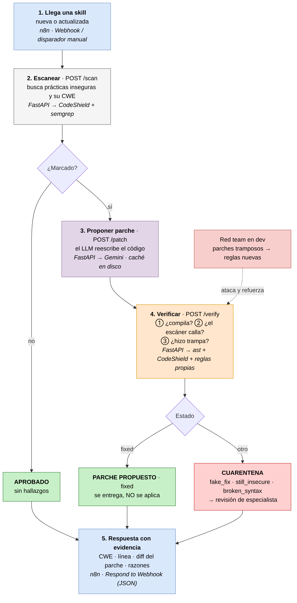
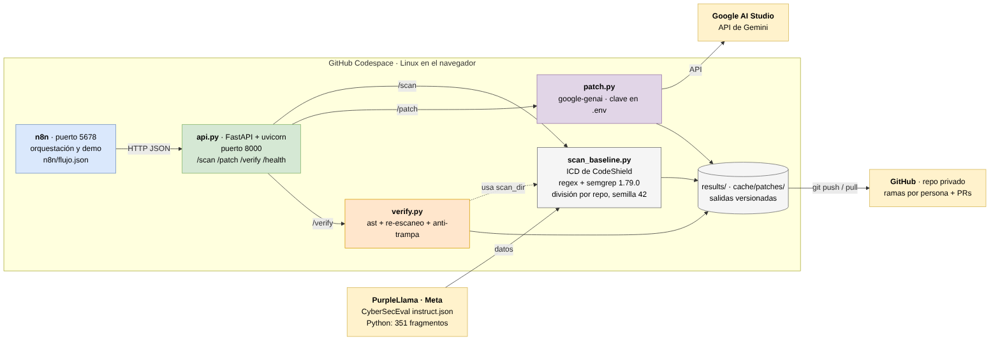
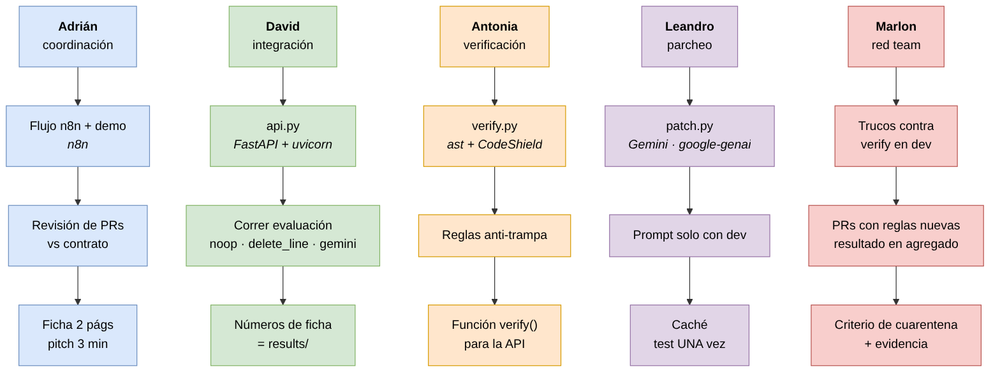
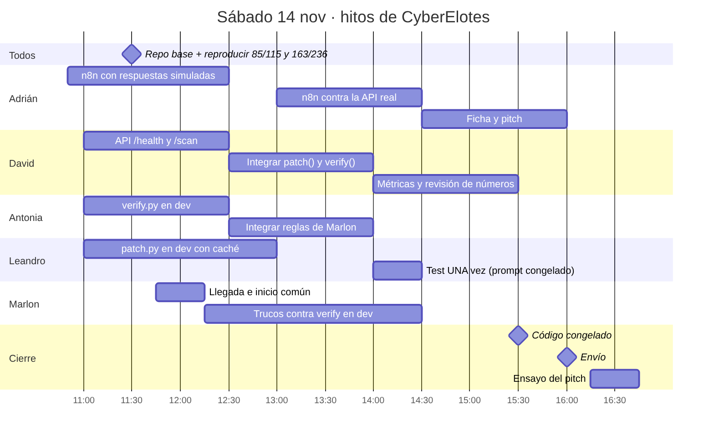
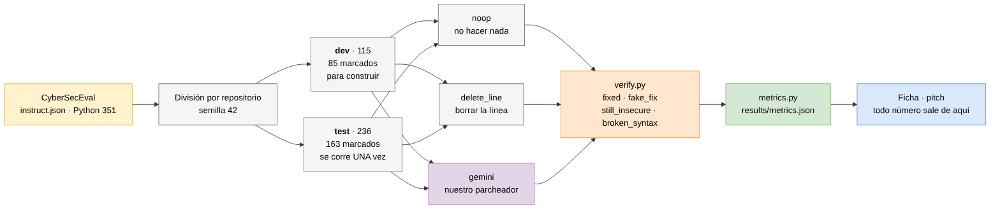
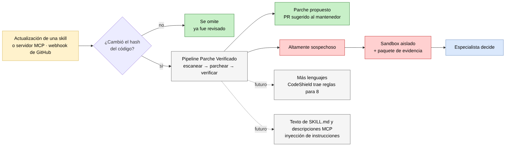

# Diagramas de CyberElotes

Cada diagrama existe en tres formatos: `.png` (para ver o insertar en Lucidchart/slides), `.svg` (vectorial, sin pérdida al ampliar) y `.mmd` (fuente Mermaid, editable).

## 1. Cómo funciona el producto (con la tecnología de cada paso)

## 2. Arquitectura y stack

## 3. División del trabajo

## 4. Cronograma del sábado

## 5. Cómo se producen los números

## 6. Cómo escala (visión, no se construye hoy)

Colores por dueño: Adrián azul · David verde · Antonia naranja · Leandro morado · Marlon rojo · ya existe gris · externo amarillo.
