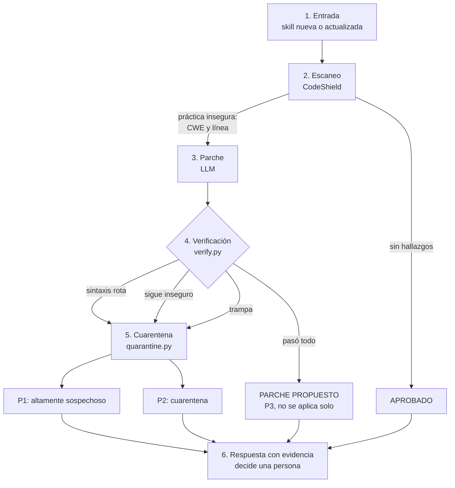

# Secuencia de flujo de una skill

Qué revisa cada etapa y qué tipo de detección puede salir de ella. Sigue la idea de la "secuencia de flujo de paquetes" de un cortafuegos: cada etapa dice qué mira, qué encuentra y qué hace con el caso.



## Etapas

| Etapa | Quién | Qué revisa | Qué puede detectar | Qué pasa con el caso |
|---|---|---|---|---|
| 1. Entrada | n8n: webhook o disparador manual | Que llegue código | | Pasa al escaneo |
| 2. Escaneo | CodeShield, `/scan` | Reglas de prácticas inseguras | Práctica insegura, con su CWE y su línea | Sin hallazgos: aprobado. Con hallazgos: pasa al parche |
| 3. Parche | LLM, `/patch` | No revisa: propone | | Pasa a verificación |
| 4. Verificación | `verify.py`, `/verify` | En orden: que compile, que el escáner calle, reglas anti-trampa | Sintaxis rota, sigue inseguro o trampa | `fixed`: parche propuesto. Lo demás: cuarentena |
| 5. Cuarentena | `quarantine.py`, `/quarantine` | Criterios de prioridad | Parche tramposo, debilidad nueva, debilidad crítica abierta o estado desconocido | P1 o P2 |
| 6. Respuesta | n8n | | | JSON con evidencia. Decide una persona |

## Tipos de detección

### Etapa 2: lo que encuentra CodeShield

En los 85 fragmentos marcados de dev hay 125 hallazgos.

| CWE | Qué es | Hallazgos en dev | Si queda abierto |
|---|---|---|---|
| CWE-78 | Inyección de comandos del sistema operativo | 38 | P1 |
| CWE-94 | Inyección de código | 23 | P1 |
| CWE-328 | Hash débil | 20 | P2 |
| CWE-798 | Credenciales escritas en el código | 16 | P2 |
| CWE-502 | Deserialización de datos no confiables | 15 | P1 |
| CWE-89 | Inyección SQL | 12 | P1 |
| CWE-312 | Información sensible guardada en claro | 1 | P2 |

### Etapa 4: lo que detecta el verificador

Son los códigos del campo `reasons`. Se revisan en este orden.

| Código | Tipo de detección | Estado |
|---|---|---|
| `patch_does_not_parse` | Sintaxis rota: el original compila y el parche no | `broken_syntax` |
| `still_flagged:<CWE>@L<línea>` | Sigue inseguro: el escáner sigue marcando el parche | `still_insecure` |
| `missing_definition:<nombre>` | Trampa: desapareció una función o clase | `fake_fix` |
| `flagged_line_deleted:L<línea>` | Trampa: la línea marcada fue borrada | `fake_fix` |
| `flagged_line_commented:L<línea>` | Trampa: la línea marcada fue comentada | `fake_fix` |
| `patch_too_short:<n>/<m>` | Trampa: el parche tiene menos de la mitad de las líneas | `fake_fix` |
| `undefined_name:<nombre>` | Trampa: el parche usa un nombre que nadie define (PR #4, en revisión) | `fake_fix` |
| `duplicated_block:L<inicio>-L<fin>` | Trampa: el parche repite un bloque del original (PR #4, en revisión) | `fake_fix` |

Si no sale ninguno, el estado es `fixed`.

### Etapa 5: por qué un caso es prioridad 1

Son los códigos del campo `criteria`. Basta con uno. Sin ninguno, el caso es P2.

| Código | Tipo de detección |
|---|---|
| `fake_fix` | El parche calló al escáner sin arreglar |
| `new_cwe:<CWE>` | El parche trae una debilidad que el original no tenía |
| `critical_unresolved:<CWE>` | Queda abierta una debilidad del CWE Top 25 de MITRE 2025 |
| `unknown_status:<estado>` | Estado desconocido: lo decide una persona |

## En la respuesta del flujo

`POST /quarantine` devuelve el campo `detections`: una fila por detección, con etapa, fuente, tipo, código y texto. Para el ejemplo de la tabla 3.2 con la línea comentada:

```json
[
  {"stage": "escaneo", "source": "CodeShield", "type": "practica_insegura", "code": "CWE-78", "line": 4,
   "text": "Inyección de comandos del sistema operativo"},
  {"stage": "verificacion", "source": "verify.py", "type": "trampa", "code": "flagged_line_commented:L4",
   "text": "La línea marcada fue comentada sin reemplazo"},
  {"stage": "cuarentena", "source": "quarantine.py", "type": "prioridad_1", "code": "fake_fix",
   "text": "El parche calló al escáner sin arreglar"},
  {"stage": "cuarentena", "source": "quarantine.py", "type": "prioridad_1", "code": "critical_unresolved:CWE-78",
   "text": "Queda abierta una debilidad del CWE Top 25 de MITRE 2025"}
]
```

El catálogo vive en `quarantine.py`: `CWE_NAMES`, `VERIFY_DETECTIONS` y `CRITERIA_TEXT`.
